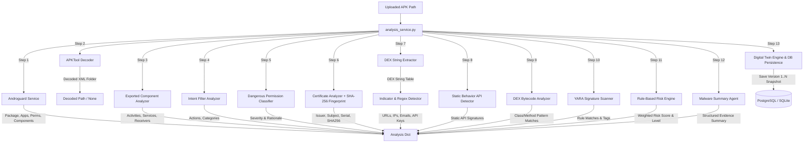

# CRYPTIX VERIFIED STATIC ANALYSIS PIPELINE

**Document Version:** 1.0.0  
**Last Updated:** September 8, 2026  

---

## 1. Verified Pipeline Architecture

The static analysis pipeline is orchestrated in `backend/app/services/analysis_service.py`. Each analytical module is wrapped in error boundaries to ensure high system resilience. If a non-critical analyzer encounters an issue (e.g. uninstalled Java runtime or malformed XML), the failure is cleanly logged and recorded in `analyzer_status` without terminating the request.

---

## 2. Comprehensive Analyzer Specifications

### 1. Androguard (`app/analysis/androguard_service.py`)
* **Role**: Primary APK parsing engine.
* **Input**: File path to `.apk`.
* **Output**: `package_name`, `app_name`, `version_name`, `version_code`, `min_sdk`, `target_sdk`, `permissions`, `activities`, `services`, `receivers`.
* **Resilience**: Returns fallback metadata if parsing fails.

### 2. APKTool Decoder (`app/apktool/decoder.py`)
* **Role**: Static disassembly of APK resources and XML.
* **Input**: File path to `.apk`.
* **Output**: Directory path to `decoded/<stem>` folder containing plaintext `AndroidManifest.xml`.
* **Resilience**: Verifies Java executable presence (`shutil.which("java")`), enforces 60s execution timeout, cleans up temp folder on error, returns `None` on failure.

### 3. Exported Component Analyzer (`app/manifest/exported_analyzer.py`)
* **Role**: Identifies publicly reachable components (`android:exported="true"`).
* **Input**: Decoded folder path.
* **Output**: Categorized list of exported activities, services, receivers, and providers.

### 4. Intent Filter Analyzer (`app/manifest/intent_filter_analyzer.py`)
* **Role**: Parses intent filter actions and categories.
* **Input**: Decoded folder path.
* **Output**: List of activity intent filter actions and categories.

### 5. Permission Classifier (`app/security/manifest_analyzer.py`)
* **Role**: Maps extracted permissions against `DANGEROUS_PERMISSIONS` dictionary.
* **Input**: Permission string list.
* **Output**: List of dangerous permissions with assigned severities (Low, Medium, High, Critical) and rationale.

### 6. Certificate Analyzer (`app/certificate/certificate_analyzer.py`)
* **Role**: X.509 Certificate extraction and SHA-256/SHA-1 cryptographic fingerprinting.
* **Input**: File path to `.apk`.
* **Output**: `issuer`, `subject`, `serial_number`, `sha256_fingerprint`, `sha1_fingerprint`, validity dates.

### 7. String & Indicator Detector (`app/string_analysis/`)
* **Role**: Extracts DEX strings and applies regex patterns.
* **Input**: DEX string table.
* **Output**: Extracted URLs, IP addresses, emails, Firebase databases, API keys, Base64 strings, and Bitcoin wallet addresses.

### 8. Static Behavior Detector (`app/behavior_analysis/behavior_detector.py`)
* **Role**: Static pattern matching of sensitive Android API string names (`Runtime.exec`, `su`, `DexClassLoader`).
* **Note**: Refers to static signature presence, NOT dynamic runtime execution.

### 9. DEX Bytecode Analyzer (`app/dex_analysis/dex_analyzer.py`)
* **Role**: Class and method bytecode inspection against `API_PATTERNS`.
* **Output**: Detected reflection, dynamic class loading, cryptography, networking, and filesystem API invocations.

### 10. YARA Scanner (`app/yara_engine/yara_scanner.py`)
* **Role**: Signature rule matching.
* **Input**: File path to `.apk`.
* **Output**: Matched YARA rules, namespaces, tags, and severity levels.

### 11. Risk Engine (`app/security/risk_engine.py`)
* **Role**: Rule-based weighted scoring (Critical=25, High=15, Medium=8, Low=3).
* **Output**: Numerical `risk_score` and `risk_level` (Low, Medium, High, Critical).

### 12. Malware Summary Agent (`app/agents/malware_agent.py`)
* **Role**: Deterministic evidence summarizer function formatting findings and recommended actions.
* **Note**: Rule-based text generation, NOT an LLM multi-agent framework.

### 13. Digital Twin System (`app/digital_twin/`)
* **Role**: Synthesis and persistence of versioned security posture state snapshots into database.
