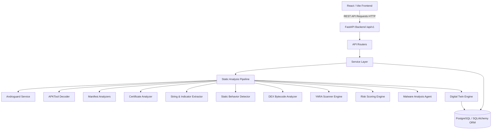
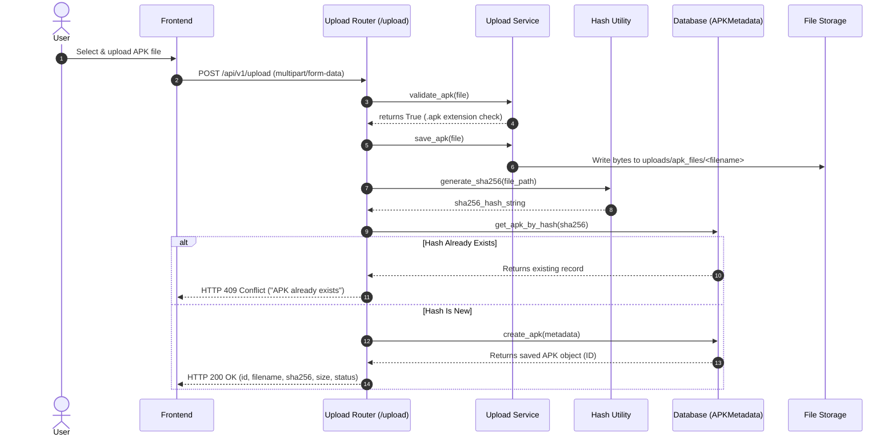
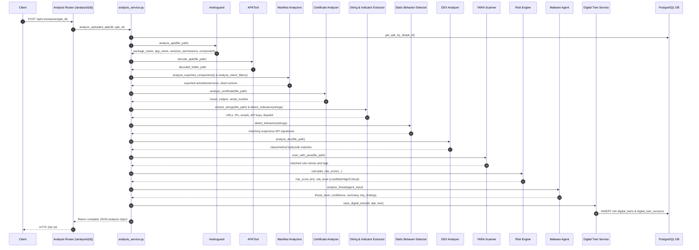

# CRYPTIX CURRENT SYSTEM ARCHITECTURE & TECHNICAL GUIDE

**Project Name:** CRYPTIX (Targeting Garud-AI Platform)  
**Document Version:** 1.0.0  
**Date:** September 8, 2026  

---

## 1. High-Level System Architecture

The current system is built as a decoupled **Client-Server Architecture**:



---

## 2. Component Architecture Deep-Dive

### A. Frontend Architecture
* **Framework:** React 19 + Vite 8 (ESM JavaScript).
* **HTTP Client:** Axios configured with base URL `http://127.0.0.1:8000/api/v1`.
* **State Management:** Local React component state (`useState`, `useEffect`).
* **Visualizations:** Recharts for pie chart (`RiskDistributionChart`) and bar chart (`TopPermissionsChart`).
* **Current Pages:** Single page (`Dashboard.jsx`) rendered by `App.jsx`.

### B. Backend Architecture
* **Framework:** FastAPI (Python asynchronous ASGI framework).
* **Entry Point:** `app/main.py`.
* **Middlewares:** `CORSMiddleware` configured to allow all origins (`*`).
* **Configuration:** `app/config/settings.py` loads environment variables via `python-dotenv`.
* **Logger:** Custom logger wrapping standard Python `logging` module in `app/core/logger.py`.

### C. Database Architecture
* **ORM:** SQLAlchemy 2.0 (`declarative_base()`, `sessionmaker`).
* **Database Driver:** `psycopg2-binary` for PostgreSQL.
* **Core Models:**
  1. `APKMetadata` (`apk_metadata` table): Stores uploaded APK file metadata (`id`, `file_name`, `sha256`, `file_size`, `file_path`, `package_name`, `version`, `status`, `upload_time`).
  2. `APKAnalysis` (`apk_analysis` table): Stores basic Android manifest info (`apk_id`, `package_name`, `app_name`, `version_name`, `version_code`, `min_sdk`, `target_sdk`).
  3. `DigitalTwin` (`digital_twins` table): Tracks top-level Digital Twin instance (`id`, `apk_id`, `package_name`, `app_name`, `current_version`, `created_at`, `updated_at`).
  4. `DigitalTwinVersion` (`digital_twin_versions` table): Stores complete versioned security snapshot in JSON columns (`permissions`, `dangerous_permissions`, `exported_components`, `intent_filters`, `certificate`, `indicators`, `behaviors`, `dex_findings`, `yara_matches`, `risk_score`, `risk_level`, `threat_level`).

---

## 3. Data Flows & Sequences

### A. APK Upload Flow



### B. SHA-256 Flow & Significance

```text
APK File Stream
     ↓
SHA-256 Hash Function (hashlib.sha256)
     ↓
64-character Hexadecimal Hash String
     ↓
Query Local DB: `SELECT * FROM apk_metadata WHERE sha256 = :hash`
     ↓
├── Match Found    → Local Exact-Sample Match (Return existing APK record / HTTP 409)
└── Match Not Found → New Local Sample (Proceed to Storage & DB Entry)
```

**Technical Clarification:**
SHA-256 provides a unique cryptographic fingerprint for **exact file identity**.
* It answers: *"Have we processed this exact file in our local database before?"*
* It does **NOT** answer: *"Is this file malicious globally?"* or *"Is this a variant of known malware?"* (That requires external Threat Intelligence lookup and Malware DNA similarity matching).

---

### C. Static Analysis Pipeline Flow



---

## 4. Comprehensive Analyzer Explanations

### 1. Androguard Integration (`app/analysis/androguard_service.py`)
* **What it is:** Python reverse-engineering tool for Android files.
* **Why used:** Parses binary Android XML (`AndroidManifest.xml`) and DEX headers directly in Python without unzipping external tools.
* **Input:** Raw `.apk` file path.
* **Output:** Dict containing `package_name`, `app_name`, `version_name`, `version_code`, `min_sdk`, `target_sdk`, `permissions`, `activities`, `services`, `receivers`.

### 2. APKTool Decoder (`app/apktool/decoder.py`)
* **What it is:** Standard Android reverse engineering tool wrapper.
* **Why used:** Decodes binary XML resources into human-readable plaintext XML and disassembles DEX bytecode into Smali files.
* **Input:** Raw `.apk` file path.
* **Execution:** Calls `java -jar tools/apktool/apktool.jar d -f <apk_path> -o decoded/<stem>`.
* **Output:** Path to decoded directory containing readable `AndroidManifest.xml` and `smali/` folders.

### 3. Manifest Analysis (`app/manifest/`)
* **Exported Components (`exported_analyzer.py`):** Uses `lxml.etree` to find `<activity>`, `<service>`, `<receiver>`, `<provider>` elements where `android:exported="true"`. Exported components can be launched by any external app, posing attack surface vulnerabilities.
* **Intent Filters (`intent_filter_analyzer.py`):** Parses `<intent-filter>` elements for `<action>` and `<category>` (e.g. `android.intent.action.BOOT_COMPLETED` for persistent auto-start on device reboot).
* **Permission Analysis (`app/security/manifest_analyzer.py`):** Matches permissions against `DANGEROUS_PERMISSIONS` dictionary to classify severity (High/Critical) and rationale (e.g., `SEND_SMS` allows financial toll fraud).

### 4. Certificate Analysis (`app/certificate/certificate_analyzer.py`)
* **What it does:** Extracts X.509 signing certificate details via Androguard (`apk.get_certificates()`).
* **Input:** Raw `.apk` file path.
* **Output:** Issuer name, subject name, serial number.

### 5. String Analysis (`app/string_analysis/`)
* **String Extractor (`string_extractor.py`):** Calls `dex.get_strings()` across all DEX files to collect static string constants.
* **Indicator Detector (`indicator_detector.py`):** Scans collected strings using Regular Expressions (`re`) to extract C2 URLs, IP addresses, email addresses, Firebase databases, API keys, Base64 blocks, and Bitcoin wallet addresses.

### 6. Behavior Analysis (`app/behavior_analysis/behavior_detector.py`)
* **IMPORTANT CLARIFICATION:** The current implementation is **STATIC BEHAVIOR SIGNATURE MATCHING**.
* It checks if suspicious API string names (e.g., `getLine1Number`, `sendTextMessage`, `Cipher.getInstance`) exist in the DEX string pool.
* It does **NOT** observe actual dynamic runtime execution in an Android emulator or device sandbox.

### 7. DEX Analysis (`app/dex_analysis/dex_analyzer.py`)
* **What it does:** Iterates through DEX classes (`dex.get_classes()`) and methods (`cls.get_methods()`).
* **Pattern Matching:** Matches class names and method signatures against `API_PATTERNS` dictionary (detecting reflection `Class.forName`, dynamic loading `DexClassLoader`, crypto operations `Cipher`, root detection `su`).

### 8. YARA Scanner Engine (`app/yara_engine/yara_scanner.py`)
* **What it is:** Signature matching engine for malware research.
* **Execution:** Compiles `.yar` files located in `app/yara_engine/rules/` and scans the raw `.apk` file.
* **Output:** List of matched rule names, rule namespaces, tags, and rule metadata severities.

### 9. Risk Scoring Engine (`app/security/risk_engine.py`)
* **IMPORTANT CLARIFICATION:** The risk scoring engine is **RULE-BASED**, NOT Machine Learning.
* **Weights:**
  * `Critical` finding = +25 points
  * `High` finding = +15 points
  * `Medium` finding = +8 points
  * `Low` finding = +3 points
* **Risk Levels:**
  * Score $\ge 70 \implies$ **Critical**
  * Score $40 - 69 \implies$ **High**
  * Score $20 - 39 \implies$ **Medium**
  * Score $< 20 \implies$ **Low**

### 10. Digital Twin System (`app/digital_twin/`)
* **Concept:** A persistent, versioned digital replica of an APK's security posture over time.
* **State Capture:** Stores all extracted permissions, components, certificate info, indicators, behaviors, DEX findings, YARA matches, and risk scores into `digital_twin_versions`.
* **Drift Detection:** Compares Version $N$ against Version $N-1$ to detect newly added dangerous permissions, modified components, or risk escalation.
