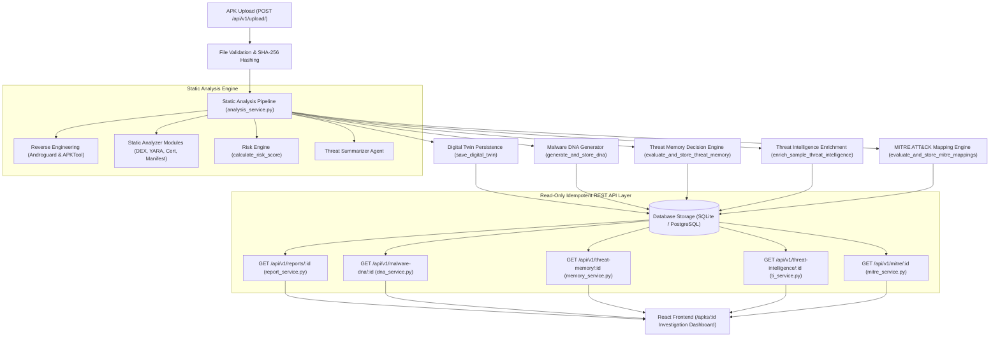

# CRYPTIX / GARUD-AI — Complete System Architecture & Data Flow

This document details the end-to-end data flow of the GARUD-AI / CRYPTIX Android Malware Analysis Engine, tracing data movement from APK upload through static reverse engineering, Digital Twin snapshot creation, DNA fingerprinting, Threat Memory evaluation, Threat Intelligence enrichment, MITRE ATT&CK mapping, REST API response serialization, and React UI rendering.

---

## 1. System Data Flow Overview

---

## 2. Stage-by-Stage Data Flow Specification

### Stage 1: Upload & Duplicate Detection
1. **HTTP Endpoint**: `POST /api/v1/upload/` (`backend/app/api/v1/upload.py`)
2. **Operations**:
   - Validates `.apk` file extension and ZIP magic header (`PK\x03\x04`).
   - Computes deterministic `SHA-256` hash of the raw byte stream.
   - Queries `APKMetadata` table for duplicate SHA-256 hashes.
   - Saves file to disk `uploads/{sha256}.apk` and creates `APKMetadata` record.
   - Triggers `analyze_uploaded_apk(db, apk.id)`.

### Stage 2: Static Analysis Pipeline
1. **Engine**: `backend/app/services/analysis_service.py`
2. **Sub-analyzers**:
   - **Androguard**: Extracts package name, app name, permissions, activities, services, receivers.
   - **APKTool**: Decodes `AndroidManifest.xml` to parse exported components and intent filters.
   - **DEX Analyzer**: Scans Dalvik bytecode for reflective calls, dynamic class loading, and suspicious API invocations.
   - **YARA Scanner**: Executes compiled YARA rules against DEX strings and resources.
   - **Certificate Analyzer**: Extracts X.509 signature metadata, issuer, subject, self-signed status.
   - **Risk Engine**: Calculates deterministic 0-100 risk score based on weighted indicator severities.

### Stage 3: Digital Twin Snapshot Creation
1. **Engine**: `backend/app/digital_twin/digital_twin_service.py`
2. **Operations**:
   - Compiles static state into `DigitalTwinState` pydantic model.
   - If no `DigitalTwin` exists for `apk_id`, creates `DigitalTwin` record and inserts `DigitalTwinVersion` (Version 1).
   - If an explicit re-analysis POST request is received (`POST /api/v1/analysis/:id`), creates `DigitalTwinVersion` (Version N+1).

### Stage 4: DNA Fingerprinting & Threat Memory
1. **Malware DNA**:
   - `backend/app/malware_dna/dna_service.py` normalizes canonical feature sets (permissions, behaviors, DEX findings, YARA matches).
   - Computes deterministic `SHA-256` canonical feature hash and calculates Jaccard similarity matrices.
2. **Threat Memory**:
   - `backend/app/threat_memory/memory_service.py` queries historical corpus.
   - Classifies sample into `KNOWN_EXACT`, `HIGH_SIMILARITY`, `RELATED_SAMPLE`, or `NEW_SAMPLE`.

### Stage 5: Threat Intelligence & MITRE Mapping
1. **Threat Intelligence**:
   - `backend/app/threat_intelligence/service.py` checks VirusTotal, AbuseIPDB, and AlienVault OTX using hash lookups.
   - Raw binary bytes are never uploaded. Provider status is tracked as `CONNECTED`, `NOT_FOUND`, or `NOT_CONFIGURED`.
2. **MITRE ATT&CK**:
   - `backend/app/mitre/service.py` maps static evidence to Mobile ATT&CK v15.1 technique catalog using deterministic rule conditions.

### Stage 6: Idempotent REST API & React UI Rendering
1. **REST API**:
   - `GET /api/v1/reports/:id` uses `generate_apk_report(db, apk_id)`.
   - Reads existing `DigitalTwin` and `DigitalTwinVersion` records directly from DB without calling `analyze_uploaded_apk`, ensuring 100% read-only idempotency across GET requests, tab changes, and page refreshes.
2. **React Dashboard**:
   - `/apks/:id` renders tab components (`ManifestTab`, `MalwareDNATab`, `ThreatMemoryTab`, `GlobalThreatIntelligenceTab`, `MitreTab`).
   - Each tab renders data, informative 404/not-generated empty states, or 500 error banners with clear security notices.
